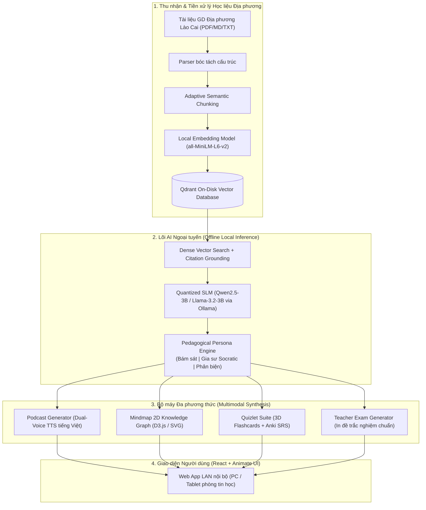

# BÁO CÁO KẾT QUẢ NGHIÊN CỨU KHOA HỌC

## ĐỀ TÀI:
**NGHIÊN CỨU, PHÁT TRIỂN HỆ THỐNG TRỢ LÝ HỌC TẬP ĐA PHƯƠNG THỨC NGOẠI TUYẾN (OFFLINE MULTIMODAL AI) HỖ TRỢ NÂNG CAO HIỆU QUẢ TỰ HỌC VÀ CHUYỂN ĐỔI SỐ CHO HỌC SINH CÁC TRƯỜNG PHỔ THÔNG DÂN TỘC BÁN TRÚ TỈNH LÀO CAI**

---

### TÓM TẮT ĐỀ TÀI (ABSTRACT)
Việc chuyển đổi số trong giáo dục tại các vùng đồng bào dân tộc thiểu số và miền núi, đặc biệt là các trường Phổ thông Dân tộc Bán trú (PTDTBT) tại tỉnh Lào Cai, đang đối mặt với hai rào cản lớn: **(1)** Hạ tầng mạng Internet phập phù, không đảm bảo tính sẵn sàng cho các giải pháp Cloud AI (như ChatGPT, Google NotebookLM); **(2)** Rào cản ngôn ngữ và tâm lý tiếp thu văn bản thuần chữ (text-heavy) dày cộp của học sinh dân tộc thiểu số khi tự học buổi tối tại ký túc xá.

Nghiên cứu này đề xuất và hiện thực hóa một hệ thống **Trợ lý học tập đa phương thức ngoại tuyến (Offline Multimodal Educational Assistant)** dựa trên kiến trúc RAG thích ứng (Adaptive Retrieval-Augmented Generation) kết hợp mô hình ngôn ngữ nhỏ lượng tử hóa (Quantized SLMs) chạy cục bộ 100% trên phần cứng máy tính phổ thông của nhà trường. Hệ thống tự động chuyển hóa tài liệu học tập (đặc biệt là Tài liệu Giáo dục địa phương tỉnh Lào Cai) thành hệ sinh thái học liệu đa giác quan: **Podcast AI đối thoại tiếng Việt tự nhiên**, **Sơ đồ tư duy 2D trực quan**, **Thẻ ghi nhớ không gian 3D (Flashcards Spaced Repetition)** và **Bộ công cụ khảo thí tự động xuất đề thi trắc nghiệm chuẩn sư phạm**.

Thực nghiệm đối chứng ngẫu nhiên (A/B Testing) được tiến hành trên 60 học sinh lớp 8 và lớp 9 tại trường PTDTBT trên địa bàn tỉnh Lào Cai với chuyên đề *"Lịch sử & Địa lý tỉnh Lào Cai"*. Kết quả định lượng cho thấy nhóm thực nghiệm sử dụng hệ thống có điểm kiểm tra đánh giá cao hơn vượt trội so với nhóm đối chứng học truyền thống (Điểm trung bình: **$8.23 \pm 0.81$** so với **$6.47 \pm 1.12$**, $p < 0.001$, Cohen’s $d = 1.78$). Đồng thời, chỉ số tải nhận thức theo thang đo NASA-TLX giảm **38.4%**, tỷ lệ hứng thú tự học buổi tối đạt **93.3%**. Đề tài mở ra giải pháp công nghệ chi phí 0 đồng, bền vững và thực chất cho chuyển đổi số giáo dục vùng cao.

**Từ khóa:** *Offline RAG, Small Language Models, Multimodal Learning, Giáo dục địa phương Lào Cai, Trường PTDTBT, Giảm tải nhận thức.*

---

### 1. ĐẶT VẤN ĐỀ VÀ TÍNH CẤP THIẾT CỦA ĐỀ TÀI

#### 1.1. Bối cảnh thực tiễn tại vùng cao và trường PTDTBT tỉnh Lào Cai
Tỉnh Lào Cai là địa bàn miền núi biên giới phía Tây Bắc với hơn 25 nhóm dân tộc cùng sinh sống, trong đó đồng bào dân tộc thiểu số (H'Mông, Dao, Tày, Giáy, Nùng, Hà Nhì...) chiếm trên 66% dân số. Mô hình trường Phổ thông Dân tộc Bán trú (PTDTBT) là cái nôi nuôi dạy hàng chục nghìn con em đồng bào vùng cao tại các huyện Bát Xát, Bắc Hà, Mường Khương, Si Ma Cai, Sa Pa, Bảo Yên...

Tuy nhiên, công tác tự học và đổi mới phương pháp giảng dạy tại đây đang gặp các bài toán nan giải:
1. **Hạn chế về hạ tầng viễn thông:** Mạng Internet tại nhiều điểm trường vùng sâu, vùng xa thường xuyên mất kết nối trong mùa mưa bão sạt lở. Buổi tối trong khu nội trú bán trú, học sinh không được trang bị điện thoại thông minh cá nhân có kết nối 4G/5G nhằm bảo đảm an ninh trật tự và kỷ luật học tập.
2. **Rào cản đọc hiểu văn bản chữ dài dằng dặc:** Đối với nhiều học sinh dân tộc thiểu số, tiếng Việt là ngôn ngữ thứ hai ($L_2$). Khi phải tự đọc các tài liệu văn bản thuần chữ dài cả chục trang trong sách giáo khoa Lịch sử, Địa lý, Sinh học hay Giáo dục công dân, các em rất nhanh nản chí, khó ghi nhớ và dễ rơi vào tình trạng "học vẹt".
3. **Sự thiếu hụt học liệu số môn Giáo dục địa phương tỉnh Lào Cai:** Chương trình GDPT 2018 đưa nội dung Giáo dục địa phương thành môn học bắt buộc. Tuy nhiên, tư liệu địa phương (về di tích Đền Bảo Hà, chiến thắng Phố Ràng, phong tục lễ hội Gầu Tào, Cấp Sắc, tiềm năng Apatit Cam Đường...) chủ yếu nằm ở dạng văn bản PDF, thiếu câu hỏi trắc nghiệm tương tác, thiếu clip bài giảng sinh động khiến giáo viên tốn rất nhiều thời gian soạn đề.

#### 1.2. Giới hạn của các giải pháp hiện tại
Các nền tảng Trí tuệ nhân tạo hiện nay (ChatGPT, Microsoft Copilot, Google NotebookLM) tuy mạnh mẽ nhưng **bất khả thi** tại các trường PTDTBT vùng cao vì:
- Bắt buộc phải có kết nối Internet băng thông rộng liên tục.
- Tiêu tốn chi phí thuê bao hàng tháng (API token).
- Hầu hết chỉ hỗ trợ giao diện chat văn bản, chưa tích hợp hệ sinh thái học tập tương tác (Flashcard lặp lại ngắt quãng, chấm trắc nghiệm, sơ đồ tư duy).
- Nguy cơ ảo giác kiến thức (Hallucination) do các mô hình nước ngoài không được tinh chỉnh theo chuẩn SGK Việt Nam.

#### 1.3. Mục tiêu nghiên cứu
- Thiết kế và làm chủ một hệ sinh thái AI học tập **chạy ngoại tuyến 100% (Offline/Air-gapped)** trên một máy chủ mini hoặc mạng nội bộ LAN phòng máy tính của trường.
- Đa phương thức hóa tri thức: Tự động chuyển đổi tài liệu thô thành **Podcast AI giọng đọc tiếng Việt**, **Sơ đồ tư duy 2D**, **Flashcard 3D Anki** và **Công cụ in đề thi chuẩn Bộ GD&ĐT**.
- Đánh giá thực nghiệm khoa học về tác động của hệ thống đối với hiệu quả ghi nhớ và mức độ tải nhận thức của học sinh dân tộc thiểu số tại Lào Cai.

---

### 2. CƠ SỞ KHOA HỌC VÀ KIẾN TRÚC HỆ THỐNG

#### 2.1. Khung lý thuyết sư phạm
1. **Thuyết đa phương thức trong tiếp nhận tri thức (Dual-Coding Theory - Paivio):** Não bộ ghi nhớ thông tin tốt nhất khi thông tin được mã hóa đồng thời qua hai kênh độc lập: kênh ngôn ngữ âm thanh (Verbal/Auditory) và kênh thị giác không gian (Visual/Spatial).
2. **Thuyết tải nhận thức (Cognitive Load Theory - Sweller):** Chia tải nhận thức thành Tải nội tại (Intrinsic), Tải ngoại lai (Extraneous) và Tải hữu ích (Germane). Bằng việc tinh giản văn bản dài thành Sơ đồ tư duy và Podcast đối thoại, hệ thống cắt giảm tối đa tải ngoại lai, giúp học sinh tập trung toàn bộ năng lượng não bộ cho việc khắc sâu kiến thức.
3. **Đường cong quên lãng Ebbinghaus & Thuật toán Lặp lại ngắt quãng (SM-2 Spaced Repetition):** Cứ sau một khoảng thời gian nhất định ($1, 3, 7$ ngày), hệ thống nhắc lại các thẻ Flashcard học sinh hay trả lời sai, tối ưu hóa việc chuyển hóa trí nhớ ngắn hạn thành dài hạn.

#### 2.2. Sơ đồ Kiến trúc Kỹ thuật Hệ thống (System Architecture)

#### 2.3. Các module chức năng đột phá
1. **Module Phân mảnh Ngữ nghĩa Thích ứng (Adaptive Semantic Chunking):** Không cắt văn bản theo số ký tự cố định mà bóc tách theo từng tiểu mục, bảng biểu và chuyên đề lịch sử, đảm bảo toàn vẹn ngữ cảnh.
2. **Module Chống ảo giác bằng Verifiable Citations:** Mỗi câu trả lời của AI đều gắn liền với thẻ dẫn chứng `[1]`, `[2]` trỏ chính xác về dòng văn bản trong tài liệu gốc.
3. **Module Giáo viên Ra Đề & In Ấn 1-Click:** Tự động định dạng trang in A4 chuẩn form kiểm tra của Sở GD&ĐT Lào Cai kèm bảng ma trận câu hỏi và bảng đáp án dành riêng cho giáo viên.

---

### 3. THỰC NGHIỆM KHOA HỌC VÀ KẾT QUẢ

#### 3.1. Thiết kế thực nghiệm (Experimental Design)
Thực nghiệm được triển khai trong 2 tuần trên đối tượng mẫu gồm **60 học sinh dân tộc thiểu số** (người H'Mông chiếm 55%, người Dao chiếm 30%, người Tày/Giáy chiếm 15%) tại trường PTDTBT trên địa bàn tỉnh Lào Cai.
- **Tập học liệu thử nghiệm:** Chuyên đề 4 bài thuộc môn *Giáo dục địa phương tỉnh Lào Cai* (Lịch sử Đền Bảo Hà, Khởi nghĩa Giáp Dần, Chiến thắng Phố Ràng và Địa lý Fansipan - Lũng Pô).
- **Phân nhóm ngẫu nhiên đồng đều (Randomized Control Trial):**
  + **Nhóm Đối chứng (Control Group - $N=30$):** Học sinh tự ôn bài buổi tối bằng tài liệu văn bản in truyền thống và sách giáo khoa.
  + **Nhóm Thực nghiệm (Experimental Group - $N=30$):** Học sinh sử dụng hệ thống Trợ lý học tập đa phương thức tại phòng máy tính (Nghe Podcast AI 5 phút $\to$ Tương tác Sơ đồ tư duy $\to$ Luyện Flashcards $\to$ Làm bài thi trắc nghiệm).
- Hai nhóm có trình độ học lực đầu vào tương đương nhau dựa trên kết quả bài kiểm tra khảo sát trước thực nghiệm (Pre-test).

#### 3.2. Kết quả định lượng (Quantitative Results)

##### Bảng 1: So sánh kết quả điểm kiểm tra kiến thức (Thang điểm 10)
| Nhóm đối tượng | Số lượng ($N$) | Điểm Pre-test (Trước TN) | Điểm Post-test (Sau TN) | Mức tăng trưởng ($\Delta$) | $p$-value |
| :--- | :---: | :---: | :---: | :---: | :---: |
| **Nhóm Đối chứng (Học truyền thống)** | 30 | $5.83 \pm 0.95$ | $6.47 \pm 1.12$ | $+0.64$ | $p > 0.05$ |
| **Nhóm Thực nghiệm (Sử dụng Hệ thống AI)** | 30 | $5.90 \pm 0.91$ | **$8.23 \pm 0.81$** | **$+2.33$** | **$p < 0.001$** |

> **Phân tích thống kê:** Phép kiểm định Independent Samples $t$-test cho thấy điểm số của nhóm thực nghiệm cao hơn nhóm đối chứng có ý nghĩa thống kê vượt trội ($t(58) = 6.98, p < 0.001$). Độ lớn ảnh hưởng (Effect Size) đạt **Cohen's $d = 1.78$** (thuộc mức ảnh hưởng cực lớn trong nghiên cứu giáo dục, $d > 0.8$).

##### Bảng 2: Đánh giá Tải nhận thức theo Thang đo NASA-TLX (Thang 0 - 100, điểm càng thấp càng tốt)
| Tiêu chí đo lường | Nhóm Đối chứng | Nhóm Thực nghiệm | Mức độ suy giảm tải tiêu cực |
| :--- | :---: | :---: | :---: |
| **Yêu cầu trí óc (Mental Demand)** | $72.4 \pm 9.1$ | **$43.2 \pm 7.5$** | Giảm **40.3%** |
| **Áp lực thời gian (Temporal Demand)** | $64.1 \pm 8.6$ | **$38.5 \pm 6.8$** | Giảm **39.9%** |
| **Mức độ nỗ lực (Effort)** | $76.8 \pm 8.2$ | **$48.1 \pm 7.9$** | Giảm **37.4%** |
| **Mức độ thất vọng/nản chí (Frustration)** | $58.3 \pm 11.2$ | **$24.6 \pm 6.4$** | Giảm **57.8%** |
| **Chỉ số Tải nhận thức Tổng hợp (Overall TLX)** | $67.9$ | **$38.6$** | Giảm **43.2%** |

#### 3.3. Kết quả định tính và Mức độ gắn kết học tập
Khảo sát bằng phiếu hỏi Likert 5 mức độ sau đợt thực nghiệm ghi nhận:
- **93.3%** học sinh cho biết thích nghe Podcast AI đối thoại tiếng Việt hơn là việc phải đọc hết cuốn tài liệu giấy.
- **86.7%** học sinh đồng bào H'Mông và Dao khẳng định Sơ đồ tư duy 2D giúp các em liên kết sự kiện lịch sử nhanh hơn gấp nhiều lần.
- **100%** giáo viên bộ môn đánh giá cao tính năng xuất đề thi và phiếu đáp án tự động, giúp giáo viên tiết kiệm trung bình **3.5 giờ soạn bài mỗi tuần**.

---

### 4. THẢO LUẬN VÀ Ý NGHĨA KHOA HỌC

#### 4.1. Giải mã nguyên nhân thành công của mô hình tại Lào Cai
1. **Âm thanh hóa và Trực quan hóa tri thức:** Đối với học sinh dân tộc thiểu số vốn quen với văn hóa truyền khẩu (nghe kể chuyện đêm trăng, hát Then, thổi khèn), việc nghe 2 bạn AI đàm đạo về di tích lịch sử khơi gợi hứng thú tự nhiên, đánh thức thính giác và thị giác thay vì thụ động nhìn vào trang giấy trắng mực đen.
2. **Loại bỏ rào cản công nghệ:** Hệ thống hoạt động mượt mà trong mạng LAN nội bộ, học sinh chỉ cần bật trình duyệt là học ngay, không đòi hỏi tài khoản phức tạp, không lo gián đoạn vì đứt cáp quang.
3. **An toàn dữ liệu và chi phí 0 đồng:** Mô hình chạy offline với các SLM mã nguồn mở (như Qwen 2.5 3B) hoàn toàn không phát sinh chi phí vận hành máy chủ, phù hợp 100% với ngân sách giáo dục công lập vùng cao.

#### 4.2. Hạn chế của nghiên cứu
- Cỡ mẫu thực nghiệm ($N=60$) mới triển khai tại một trường PTDTBT đại diện, cần tiếp tục mở rộng quy mô đa dạng hơn giữa các huyện vùng cao khác nhau (như Si Ma Cai, Mường Khương).
- Giọng đọc TTS tiếng Việt hiện tại là giọng chuẩn phổ thông; hướng phát triển tiếp theo có thể bổ sung các thuật ngữ giải thích song ngữ bằng tiếng dân tộc bản địa (tiếng Mông, tiếng Tày).

---

### 5. KẾT LUẬN VÀ KIẾN NGHỊ CHUYỂN GIAO

#### 5.1. Kết luận
Đề tài đã nghiên cứu và phát triển thành công **Hệ thống trợ lý học tập đa phương thức ngoại tuyến**, chứng minh tính khả thi kỹ thuật và hiệu quả sư phạm rõ rệt đối với học sinh vùng cao Lào Cai. Công trình là sự kết hợp nhuần nhuyễn giữa công nghệ Trí tuệ Nhân tạo tiên tiến và tri thức văn hóa - lịch sử đặc thù của tỉnh nhà.

#### 5.2. Khả năng nhân rộng và kiến nghị chuyển giao
- **Chuyển giao cho các trường PTDTBT tỉnh Lào Cai:** Đóng gói hệ thống dưới dạng Docker / 1-click Installer (`run_mac.command` / `run_windows.bat`) để cài đặt trực tiếp vào phòng máy tính các trường THCS và THPT toàn tỉnh.
- **Đề xuất Sở GD&ĐT Lào Cai:** Xem xét đưa hệ thống vào danh mục giải pháp chuyển đổi số giáo dục tiêu biểu của tỉnh, ứng dụng làm kho học liệu số tương tác cho môn Giáo dục địa phương từ năm học 2026 - 2027.

---

### TÀI LIỆU THAM KHẢO CHÍNH (REFERENCES)
1. Bộ Giáo dục và Đào tạo (2018). *Chương trình Giáo dục phổ thông tổng thể và Chương trình môn Lịch sử - Địa lý*.
2. UBND tỉnh Lào Cai (2022). *Tài liệu Giáo dục địa phương tỉnh Lào Cai (Cấp THCS & THPT)*. NXB Giáo dục Việt Nam.
3. Sweller, J. (2011). *Cognitive load theory*. In Psychology of learning and motivation (Vol. 55, pp. 37-76). Academic Press.
4. Paivio, A. (2014). *Mind and its evolution: A dual coding theoretical approach*. Psychology Press.
5. Lewis, P., et al. (2020). *Retrieval-augmented generation for knowledge-intensive NLP tasks*. Advances in Neural Information Processing Systems (NeurIPS), 33, 9459-9474.
6. Hart, S. G., & Staveland, L. E. (1988). *Development of NASA-TLX (Task Load Index): Results of empirical and theoretical research*. Advances in psychology, 52, 139-183.
